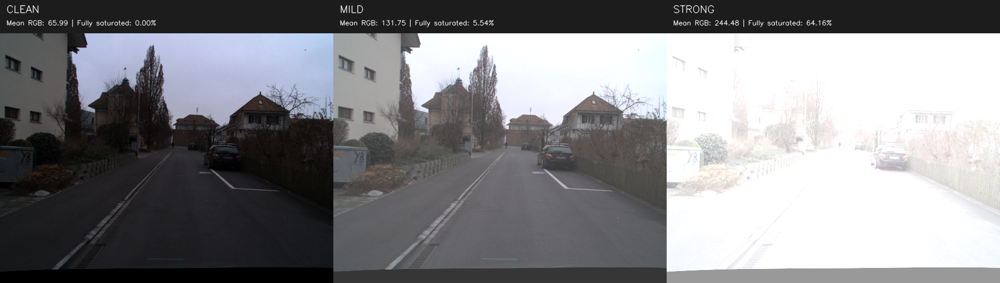
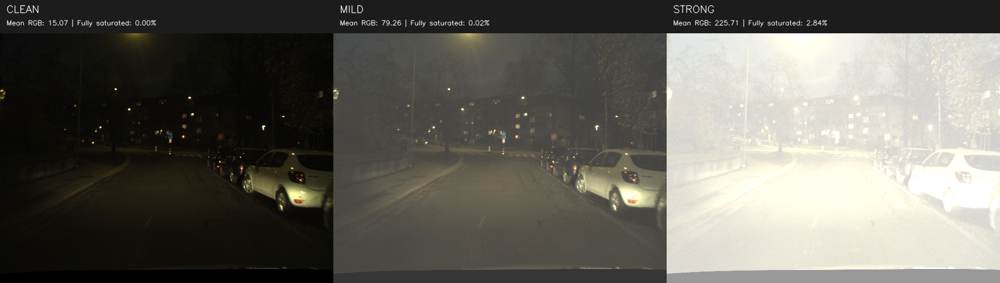

# Overexposure reference guide (Issue #41)

[Back to the project README](../../README.md)

`overexposure.py` provides `overexpose(image, strength)` for a non-empty
`H x W x 3` NumPy RGB array with dtype `uint8`. It returns a new array of
the same shape and dtype, without modifying the input or using randomness.
Convert OpenCV BGR to RGB before calling it. Apply it before converting RGB
to model tensors or concatenating event channels. This standalone function
does not change the existing training/evaluation pipeline or touch labels.

```python
from overexposure import overexpose

# rgb is a uint8 NumPy array in RGB channel order.
mild_rgb = overexpose(rgb, "mild")
strong_rgb = overexpose(rgb, "strong")
custom_rgb = overexpose(rgb, 0.6)
unchanged_copy = overexpose(rgb, 0.0)
```

Strength is either `"mild"`, `"strong"`, or a finite real number in `[0, 1]`.
Invalid array types/dtypes and invalid strength types raise `TypeError`;
invalid shapes, empty arrays, unknown presets and out-of-range or non-finite
strength values raise `ValueError`.

The parameters are defined together in `overexposure.py`:

| Preset | Strength | Gamma | Normalized brightness offset |
| --- | ---: | ---: | ---: |
| mild | 0.35 | 0.79 | 0.21 |
| strong | 1.00 | 0.40 | 0.60 |

For numeric strength `s`, each RGB channel is transformed independently:

```text
x = image / 255
gamma = 1 - (1 - MIN_GAMMA) * s       # MIN_GAMMA = 0.4
offset = MAX_BRIGHTNESS_OFFSET * s   # MAX_BRIGHTNESS_OFFSET = 0.6
output = uint8(round(255 * clip(x ** gamma + offset, 0, 1)))
```

Gamma brightens midtones; the additive offset drives highlights into clipping.
This is a controlled illumination degradation, not a physical glare simulation.

## Day and night reference examples

Each panel below shows clean, mild and strong from left to right. Sources are
640 x 480 left-camera RGB images under `images/left/distorted/`: the local
DSEC-mini day sample and the team's shared DSEC night samples. These examples
were not generated from the candidate SFNet data package.

Day: `thun_00_a/000007.png`.



Night: `zurich_city_09_a/000300.png`, the lowest strong saturation among the
four checked night frames.



Fully saturated means **all three RGB channels equal 255**. The percentage
uses every pixel, including the border. This differs from counting pixels
where any one channel is saturated.

| Sequence / frame | Clean saturated pixels | Mild saturated pixels | Strong saturated pixels |
| --- | ---: | ---: | ---: |
| thun_00_a / 000007 | 0.0000% | 5.5384% | 64.1602% |
| zurich_city_09_a / 000007 | 0.0599% | 0.1312% | 5.4274% |
| zurich_city_09_a / 000100 | 0.0081% | 0.0215% | 6.4733% |
| zurich_city_09_a / 000200 | 0.0404% | 0.1025% | 3.7484% |
| zurich_city_09_a / 000300 | 0.0016% | 0.0225% | 2.8438% |

The proposed reference saturation target is **at least 2.0% fully saturated
pixels on each of these four named night frames at strong strength**. It is
a threshold chosen from this calibration set, not a guarantee for every
night image or a separately established benchmark requirement. The same
fixed transform and parameters are used for day and night. Recheck these
results if the source images or preprocessing change.

During feature development, the five sampled frames showed increasing mean
RGB and fully saturated percentage from clean to mild to strong. Source-image
hashes and measured values are saved in
[`docs/overexposure/reference_metrics.json`](reference_metrics.json).
Model accuracy and event/label integration are outside these image checks.

## Generate examples and measurements

Run the exporter from the repository root with an original 8-bit RGB image
and a new output directory. It requires NumPy and OpenCV, but no model or GPU.

```bash
python tools/generate_overexposure_examples.py --image "/path/to/DSEC_ROOT/train/thun_00_a/images/left/distorted/000007.png" --output-dir "runs/issue41_examples/day"
python tools/generate_overexposure_examples.py --image "/path/to/DSEC_ROOT/train/zurich_city_09_a/images/left/distorted/000300.png" --output-dir "runs/issue41_examples/night"
```

Each output folder contains `clean.png`, `mild.png`, `strong.png`,
`comparison.png` and `metrics.json`. The JSON records the source-image hash,
parameters, runtime versions and mean RGB/saturation measurements. Input
images are read without changing them; existing output folders are not
overwritten. Non-ASCII Windows paths are supported.

The tool describes the generated images. It does not enforce the 2% target,
compare presets against acceptance criteria, or report test pass/fail results.
The images, measurements and documented API support independent test writing.
